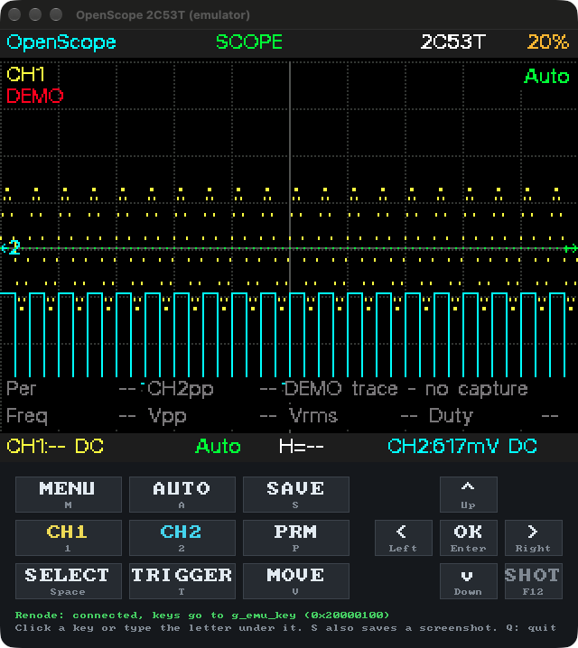

# Running the emulator

The firmware runs unchanged in [Renode](https://renode.io/), an emulated
AT32/GD32 with a model of the 2C53T's LCD. The viewer shows that LCD with
the instrument's keys underneath, which you can click or type. No hardware
needed.



## Quick start

```bash
emulator/run_emulator.sh
```

That one command builds the emulator image (`make emu`) and the viewer,
starts Renode in the background, and opens the viewer window. Close the
window (or press `Q`) and Renode stops with it.

The firmware boots into the multimeter (the default for fresh settings).
Press **MENU** three times for the oscilloscope, or let the script do it:

```bash
emulator/run_emulator.sh menu menu menu
```

Other options:

| Command | What it does |
|---|---|
| `emulator/run_emulator.sh --no-build` | Skip the firmware build (reuses `firmware/build`, which must be a `make emu` build) |
| `emulator/run_emulator.sh 3` | LCD at 3x (1 to 4, default 2) |
| `emulator/run_emulator.sh trigger down ok` | Press keys once Renode answers, in order |
| `make -C emulator run` | The same as the first command |
| `RENODE=/path/to/renode emulator/run_emulator.sh` | Renode somewhere other than `/Applications/Renode.app` |

The first build takes a minute or two: `make emu` always starts clean,
because the emulator image uses its own flags and linker script.

## Setup (once)

1. **Renode** 1.17 (checked with 1.17.1): install it to
   `/Applications/Renode.app` (macOS; steps in
   [renode/README.md](renode/README.md)), or set `RENODE`.
2. **SDL3** for the viewer: `brew install sdl3` (3.2 or later).
3. **ARM toolchain**, as for the hardware builds:
   `brew install --cask gcc-arm-embedded`.

## Keys

Click a key in the panel, or type the letter shown under it:

| Key | Keyboard | | Key | Keyboard |
|---|---|---|---|---|
| MENU | `M` | | SELECT | `Space` |
| AUTO | `A` | | TRIGGER | `T` |
| SAVE | `S` | | MOVE | `V` |
| CH1 | `1` | | arrows | arrow keys |
| CH2 | `2` | | OK | `Enter` |
| PRM | `P` | | | |

What each key does on the instrument is in
[docs/button_manual.md](../docs/button_manual.md).

- **SHOT** (or `F12`) saves the LCD as `/tmp/openscope_screenshot_NNN.bmp`
  (the next free number). **SAVE** saves one too, as the emulator's stand-in
  for a screenshot key, and also presses SAVE on the instrument.
- `Q` or `Esc` closes the viewer.
- POWER has no key here (its countdown polls the real pin).
- The status line under the keys says whether the viewer reaches Renode.
  Presses are queued and sent one at a time, so clicking fast loses
  nothing; emulated time runs slower than the clock, so a burst takes a
  moment to work through.

## What is real and what is not

The firmware is the same code as on the instrument, with `EMULATOR_BUILD`
set: the UI, menus, settings, measurements and the scope's drawing all run
for real. What it cannot have is the analog side:

- **Scope**: there is no FPGA, so the scope draws its demo trace and says
  so (`DEMO`, `DEMO trace - no capture`); measurements show `--`.
- **Meter**: there is no meter chip, so there is no reading.
- **Signal generator**: the screen and settings work; nothing comes out.

## Running it by hand (two terminals)

```bash
# Terminal 1: build the image and start Renode (monitor on port 1234)
cd firmware && make renode-interactive

# Terminal 2: build and open the viewer
cd emulator && make && ./lcd_viewer
```

`./lcd_viewer [scale] [key ...]` takes the same scale and key names as the
script. `RENODE_MONITOR_PORT` sets the port the script and the viewer use
(`make renode-interactive` always uses 1234).

## How the viewer talks to the firmware

- **Screen**: Renode's LCD model (`renode/st7789v_peripheral.py`) writes the
  frame to `/tmp/openscope_fb.bin` (320 x 240, RGB565). The viewer reads it
  every frame.
- **Keys**: the emulator build ignores the GPIO key matrix (Renode models no
  pull-ups, so it read as every key held). It takes keys from a
  one-byte mailbox instead, `g_emu_key` in `firmware/src/main.c` (button id
  + 1). The viewer writes it through Renode's monitor:
  `sysbus WriteByte <address of g_emu_key> <id + 1>`.

Renode's monitor serves one client at a time, and the viewer keeps its
connection open. With the viewer closed (Renode started by
`make renode-interactive`), the same works from a terminal, for example
MOVE (id 3):

```bash
printf 'sysbus WriteByte `sysbus GetSymbolAddress "g_emu_key"` 4\n' | nc -w 1 localhost 1234
```

Button ids are `button_id_t` in `firmware/src/ui/ui.h`.

## Troubleshooting

| Symptom | Fix |
|---|---|
| Status line: `Renode: not connected` | Renode is not running or still starting; the viewer retries every second. See its log: `$TMPDIR/openscope_renode.log` |
| Status line: `no g_emu_key in the image` | `firmware/build` holds a hardware build; run without `--no-build` |
| `Port 1234 is used by another program` | Stop that program, or `RENODE_MONITOR_PORT=1240 emulator/run_emulator.sh` |
| `make emu` fails with `can't create build/...o` | It was run with `-j`: its `clean` raced the compile. Run it without `-j` (the script does) |
| Black window, `waiting for the LCD` | The firmware has not drawn yet, or Renode failed to start: check its log |
| Viewer build: `SDL3/SDL.h not found` | `brew install sdl3` |
